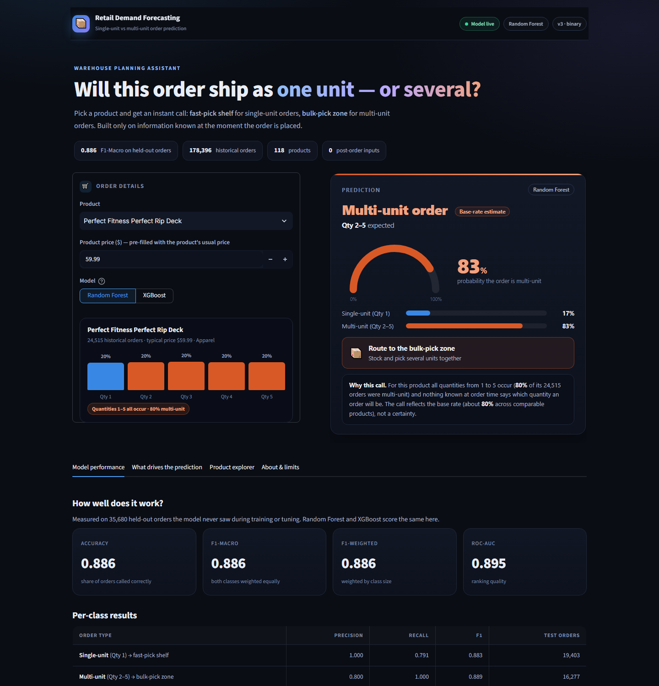
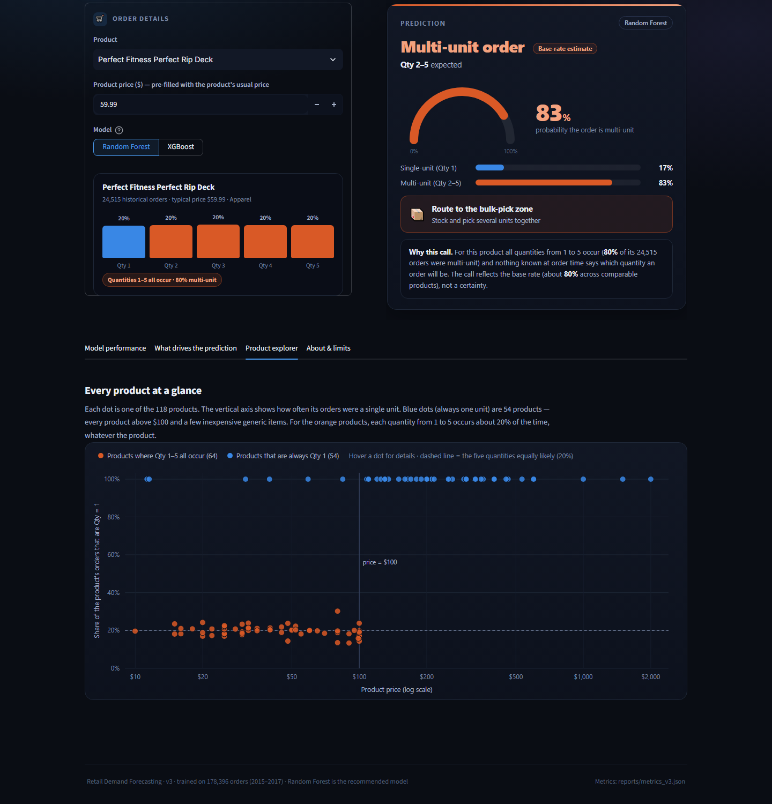

# 📦 Retail Demand Forecasting

Predicts whether an incoming retail order-item will be a **single-unit** order
(Qty = 1 → fast-pick shelf) or a **multi-unit** order (Qty 2–5 → bulk-pick
zone), using only information genuinely available at the moment the order is
placed — built for warehouse / inventory planning.

> **Status:** v3 — binary target (Single vs Multi unit), leakage-fixed,
> evaluated, explained, and deployment-ready. See
> [`PROJECT_CHANGELOG.md`](PROJECT_CHANGELOG.md) for the full history of what
> changed and why.

## What the data does — and does not — allow

The project started as a 5-class problem (predict Qty = 1, 2, 3, 4 or 5).
Investigating why every model plateaued at F1-Macro ≈ 0.39 showed that this is
a property of the data, not of the modelling:

- **54 of the 118 products are always sold as Qty = 1** (42.9 % of all rows):
  every product priced above $100, plus a few cheap generic items.
- On the **other 64 products (all priced ≤ $100), Qty 1, 2, 3, 4 and 5 each
  occur ≈ 20 % of the time — for every single product.** None of the
  pre-order information (price, month, region, segment, shipping mode, …) tells
  them apart (chi-square p > 0.05 for all of them; a model trained on shuffled
  labels scores the same as the real model).
- The only feature that ever separated Qty 2–5 was `discount_intensity`, and
  that was **target leakage**: the dollar discount equals
  *quantity × price × discount-rate* (94.1 % of discounted rows satisfy this
  identity exactly), so it is only known once the quantity is already decided.
  It has been removed (see [`PROJECT_CHANGELOG.md`](PROJECT_CHANGELOG.md) §11).

So *"one unit or several?"* is predictable from what is known at order time,
while *"exactly how many?"* (2 vs 3 vs 4 vs 5) is not. The warehouse decision
(fast-pick shelf vs bulk-pick zone) only needs the former, so the model now
answers exactly that.

## Results (held-out test set, v3)

The test set is a stratified 20 % of the rows (35,680 orders): *"a new order for a
product the business already sells"*. The model has only 107 distinct inputs, so it
cannot memorize rows; see the note on splits below and the unseen-product stress test.

| Metric | Random guess | Price-threshold rule* | **Random Forest (winner)** | XGBoost |
|---|---|---|---|---|
| Accuracy | 0.504 | 0.877 | **0.886** | 0.886 |
| F1-Macro | 0.500 | 0.877 | **0.886** | 0.886 |
| F1-Weighted | 0.504 | 0.877 | **0.886** | 0.886 |
| ROC-AUC | 0.500 | — | **0.895** | 0.897 |
| Recall — single-unit | 0.544 | 0.775 | **0.791** | 0.791 |
| Recall — multi-unit | 0.455 | 1.000 | **1.000** | 1.000 |
| F1 — single-unit | 0.544 | 0.873 | **0.883** | 0.883 |
| F1 — multi-unit | 0.456 | 0.882 | **0.889** | 0.889 |
| Precision — single-unit | 0.544 | 1.000 | **1.000** | 1.000 |
| Precision — multi-unit | 0.456 | 0.788 | **0.800** | 0.800 |
| Saved model size | — | — | **4.7 MB** | 0.1 MB |

\* *A rule learned from the training rows only: "multi-unit orders were only
ever seen up to $100, so predict single-unit above that, multi-unit
otherwise."* Full metrics and tuned hyperparameters are in
[`reports/metrics_v3.json`](reports/metrics_v3.json) and
`assets/plots/model_training/`.

**Honest reading of these numbers**

- 0.886 is at the ceiling the data allows. Above $100 the model is 100 %
  right (15,030 test rows, all single-unit). On products priced at or below that, orders are
  79 % multi-unit / 21 % single-unit with nothing to tell them apart,
  so the model predicts "multi-unit" (accuracy 80 % there, essentially the base rate).
- The ML model beats the simple price rule by only **+0.009 F1-Macro**; the gain
  comes from recognising the handful of cheap products that are always single-unit.
  Random Forest and XGBoost tie on this test — the signal is essentially a product / price lookup.
- **On products the model has never seen** (5-fold hold-out of whole products) Random Forest keeps
  F1-Macro 0.878 (min 0.824), but XGBoost falls to
  0.439 — in 4 of 5 folds it predicts "single-unit" for every order. That is why Random
  Forest is the recommended model. Treat the stress test as a warning, not a precise figure
  (few products carry most of the rows, and product-group ids were derived from a whole-dataset target mean).
- The earlier 5-class scores (F1-Macro 0.39, and 0.46 when `discount_intensity` was combined with the
  discount rate) are not comparable: same data, harder question, and the 0.46 was leakage.

**Why not a group-by-feature-combination split?** The v2 5-class work used one. With only a few
hundred distinct inputs a "feature combination" is essentially a product, so it would hold out whole
products (F1-Macro swung 0.45–0.85 by random seed on a lean model) and answer a different question
(*new product*). The stress test above covers that question explicitly.

## Evaluation & Explainability

Two dedicated phases test *whether the model can be trusted* and *why it
predicts what it predicts*:

- **Model Evaluation** (`reports/evaluation_report.json`,
  `assets/plots/evaluation/`): a learning curve (train F1-Macro
  0.885 vs CV 0.885 — no overfitting), a calibration curve (log-loss
  0.287, Brier 0.092), and error segmentation by price zone and
  price band.
- **Explainability / SHAP** (`reports/shap_feature_importance.json`,
  `assets/plots/explainability/`): SHAP TreeExplainer values on the winning
  Random Forest: `product_group` (0.252) and `product_price_log` (0.141) are the only inputs the model uses and the only ones with any effect — consistent with the analysis above.

## Repository structure

```
├── README.md, PROJECT_CHANGELOG.md, PROJECT_HANDOFF_SUMMARY.md, requirements.txt
├── .gitignore, .gitattributes
│
├── data/
│   ├── raw/                        # put Retail_demand_forecasting_dataset.csv here
│   └── processed/                  # each pipeline phase reads/writes here (gitignored — see data/README.md)
│
├── src/pipeline/                   # the 13-phase pipeline, run in order
│   ├── 01_data_cleaning.py
│   ├── 02_outlier_detection_visual.py
│   ├── 03_outlier_detection_statistical.py
│   ├── 04_outlier_treatment.py
│   ├── 05_exploratory_data_analysis.py
│   ├── 06_exploratory_data_analysis_financial.py
│   ├── 07_yeo_johnson_transformation.py
│   ├── 08_feature_engineering.py
│   ├── 09_feature_selection.py            # incl. explicit post-order / quantity-derived leakage guards
│   ├── 10_model_training.py               # binary target; trains + saves the models
│   ├── 11_build_product_department_mapping.py  # builds the app's lookup table
│   ├── 12_model_evaluation.py              # learning curve, calibration, error segmentation
│   └── 13_model_explainability_shap.py     # SHAP global importance + worked examples
│
├── app/
│   └── app.py                      # Streamlit app — run this
├── .streamlit/config.toml          # app theme (dark)
│
├── models/v3/                      # trained pipelines (Git LFS) + the app's lookup table
│   ├── random_forest_pipeline.pkl  (10.4 MB, winner)
│   ├── xgboost_pipeline.pkl        (0.1 MB)
│   ├── group_id_mapping.json
│   └── product_stats.json          # per-product order history shown in the app
│
├── reports/
│   ├── Retail_Demand_Forecasting_Project_Report.docx   # full write-up (v3)
│   ├── Previous_Retail_Demand_Preprocessing_Report.docx
│   ├── metrics_v3.json                     # Phase 10 test-set results (binary)
│   ├── evaluation_report.json              # Phase 12 learning curve / calibration / error breakdown
│   ├── shap_feature_importance.json        # Phase 13 global SHAP ranking + worked examples
│   └── eda_*.csv                           # small EDA statistical-test outputs
│
├── assets/plots/                   # every diagnostic chart, one folder per phase
│   ├── eda/, feature_engineering/, feature_selection/
│   ├── outlier_visual/, outlier_statistical/, outlier_treatment/
│   ├── yeo_johnson/, model_training/
│   ├── evaluation/                 # learning curve, calibration curve, accuracy-by-price-band
│   ├── explainability/             # SHAP global importance, beeswarm plot
│   ├── ../screenshots/             # app screenshots used in this README
│   └── ../misc/price_tier_proof.png
│
└── archive/
    ├── deprecated_v1/              # v1 modeling script + app, kept only for reference/diff
    └── pre_binary_reframe_backup/  # v2 (5-class) scripts, models, reports and plots as they were
                                    # before the v3 change — reference only
```

Every script under `src/pipeline/` and `app/` resolves its paths from its own
location (`__file__`), not from the current working directory — so you can
run any of them from anywhere, e.g. both of these work identically:

```bash
python src/pipeline/10_model_training.py
cd src/pipeline && python 10_model_training.py
```

## Running the pipeline from scratch

```bash
pip install -r requirements.txt

# 1. Put the raw dataset here:
#    data/raw/Retail_demand_forecasting_dataset.csv

# 2. Run phases in order (each writes its output into data/processed/):
python src/pipeline/01_data_cleaning.py
python src/pipeline/02_outlier_detection_visual.py
python src/pipeline/03_outlier_detection_statistical.py
python src/pipeline/04_outlier_treatment.py
python src/pipeline/05_exploratory_data_analysis.py
python src/pipeline/06_exploratory_data_analysis_financial.py
python src/pipeline/07_yeo_johnson_transformation.py
python src/pipeline/08_feature_engineering.py
python src/pipeline/09_feature_selection.py      # ~60 min (RFECV step)

# 3. Train + save the models (writes reports/metrics_v3.json, ~20-30 min):
python src/pipeline/10_model_training.py

# 4. Build the app's product/department lookup table:
python src/pipeline/11_build_product_department_mapping.py

# 5. Evaluate the winning model in depth (learning curve, calibration, error segmentation):
python src/pipeline/12_model_evaluation.py

# 6. Explain the winning model's predictions with SHAP:
python src/pipeline/13_model_explainability_shap.py
```

A smaller / larger hyperparameter search (default `n_iter=25`, `cv=5`):

```bash
MODEL_N_ITER=10 MODEL_CV_FOLDS=3 python src/pipeline/10_model_training.py
```

## Running the app

```bash
pip install -r requirements.txt
streamlit run app/app.py
```

The app is a small web page (Streamlit + custom HTML / CSS / JavaScript, dark theme configured in
[`.streamlit/config.toml`](.streamlit/config.toml)). Pick a product — optionally adjust its price — and it shows a **live
prediction**: an animated gauge with the probability of a multi-unit order, the recommended action (*fast-pick shelf* /
*bulk-pick zone*), a confidence label and a plain-language "why this call". A product card shows the product's real order
history, and four tabs cover model performance, SHAP drivers, an interactive product explorer and limitations.
Every number on the page is read from the pipeline's artifacts; the form asks only for the inputs the deployed model uses.




**Environment:** the model files were saved with Python 3.12, scikit-learn 1.9, XGBoost 3.4 and Streamlit 1.59. Use the same
scikit-learn / XGBoost versions to load them (an older scikit-learn prints an `InconsistentVersionWarning` and may fail); if you
must use different versions, re-create the models with `python src/pipeline/10_model_training.py`. The server keeps running
in the terminal you start it from — leave that window open while you use the app (Ctrl+C stops it).

The app loads `models/v3/*.pkl`, `models/v3/group_id_mapping.json` and `models/v3/product_stats.json` (the
`.pkl` files are tracked via Git LFS — run `git lfs pull` after cloning if
they look like small text pointers instead of binaries).

`archive/deprecated_v1/streamlit_app_v1_deprecated.py` is the **original,
deprecated** version — kept only for reference/diff purposes. It asks for
post-order fields (delivery status, processing delay, realized profit) that
don't actually exist yet for a real incoming order; don't deploy it. See
`PROJECT_CHANGELOG.md` §3.

## Setting up Git LFS (once, before your first commit)

```bash
git lfs install
git add .gitattributes
git add models/v3/*.pkl
git commit -m "Track v3 model files with Git LFS"
```

## Known limitations

- **Hyperparameter search used a reduced budget** (`n_iter=6, cv=3`) in the
  committed run, to fit a 1-CPU-core build environment, not the fuller
  `n_iter=25, cv=5` the scripts default to. Re-run with
  `MODEL_N_ITER=25 MODEL_CV_FOLDS=5 python src/pipeline/10_model_training.py`
  on stronger hardware for a slightly more exhaustive search.
- **Exact quantity (2 vs 3 vs 4 vs 5) is not predictable** from order-time
  information in this dataset — see "What the data does — and does not —
  allow". The model does not attempt it.
- For products priced at or below $100 the model's "multi-unit" call reflects the base
  rate (about 79 %), not order-specific evidence, and about a fifth of single-unit orders on
  those products are unavoidably predicted as multi-unit.
- **New products:** performance on products never seen in training is unstable (see
  the stress test). Random Forest holds up; XGBoost does not. Use the price rule as a fallback
  for a brand-new product.
- Phase 9 keeps only 2 features: the product identity and the price. Every order-context feature
  (date, region, segment, shipping mode, …) scored no better than random noise, and the department is
  determined by the product (each of the 118 products belongs to exactly one department), so it is dropped
  as redundant. Removing the last two weak features of an earlier version (`shipping_year`, which is the
  year of the SHIPPING date and therefore not known at order time, and `is_q4_slowdown`) left every test
  metric unchanged to the fourth decimal.
- `product_group` is recovered from `product_avg_qty`, which was computed from the target over the whole dataset;
  they are re-encoded out-of-fold inside the pipeline. The group id itself
  merges every "always single-unit" product into one group. This mirrors a
  real product property in this data but is worth knowing about.
- Winsorization caps and the Yeo-Johnson lambdas are fit on the full dataset
  before the train/test split (low severity: no target involved).
- This is a planning aid, not an inventory-automation system.

See [`PROJECT_CHANGELOG.md`](PROJECT_CHANGELOG.md) for the full engineering
history, including data-leakage fixes (temporal leakage, target-encoding
leakage), the model-size optimization, and the train/test-split fixes from
earlier iterations.
