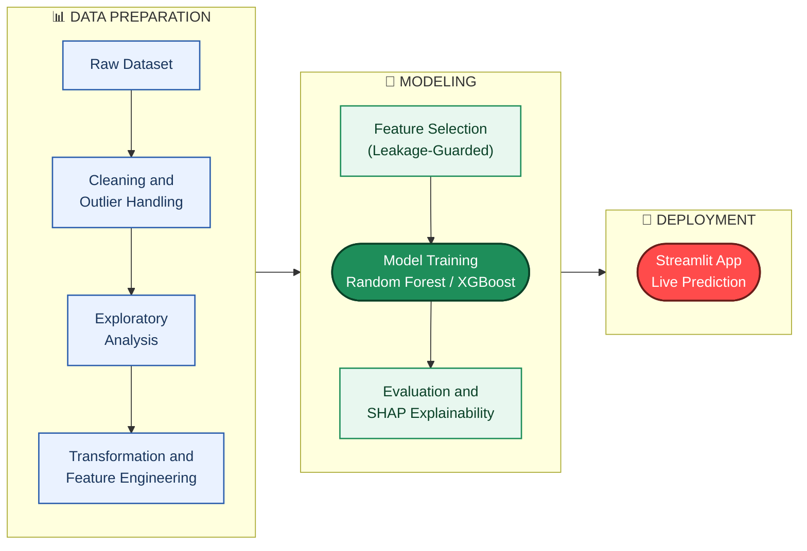

# 📦 Retail Demand Forecasting

**A data-driven classification system that predicts whether an incoming retail order-item will be a single-unit order or a multi-unit order — built to inform warehouse fast-pick vs. bulk-pick routing, using only information genuinely available at the moment the order is placed.**

---

## Overview

The **Retail Demand Forecasting** system classifies each incoming order-item as either a **single-unit order** (destined for the fast-pick shelf) or a **multi-unit order** (destined for the bulk-pick zone), so a warehouse can route it correctly before it is ever picked.

Unlike a typical modeling exercise that stops at reporting an accuracy number, this project's central contribution is a **rigorous root-cause investigation** into what the underlying dataset can and cannot support — and the disciplined decision to reframe the prediction target around that finding, rather than reporting an inflated or leakage-driven metric.

The system is implemented as a complete, end-to-end pipeline rather than a notebook exercise: data cleaning, leakage-aware feature engineering, model training, statistical evaluation, SHAP-based explainability, and a deployed interactive application are all implemented and working together.

## Problem Statement

Retail and warehouse operations that plan inventory routing face a recurring set of problems:

- **Exact demand quantity looks predictable, but often isn't.** Naively training a model to predict the exact order quantity (1, 2, 3, 4, or 5 units) can silently plateau at a low, unexplained ceiling — with no obvious diagnosis of *why*.
- **Engineered features can quietly leak the answer.** A feature that appears highly predictive during training may simply be a disguised, algebraic function of the target itself — invisible unless specifically tested for.
- **Naive train/test splits can overstate real-world performance.** With a small number of distinct products, a careless split can let near-duplicate feature combinations appear in both training and test data, producing metrics that collapse on genuinely new data.
- **A model that is wrong with confidence is worse than no model at all.** Reporting a headline accuracy number without an honest account of *where* and *why* it fails misleads the business decisions built on top of it.

What is needed is not just a model, but a trustworthy, well-diagnosed answer to *which* question this data can actually answer.

## Our Solution

The project addresses this through a disciplined, evidence-first workflow rather than iterative hyperparameter tuning:

1. **Diagnose before tuning.** When every model plateaued at F1-Macro ≈ 0.39 on the original 5-class target, the response was statistical investigation — chi-square independence tests and a shuffled-label control model — not further tuning.
2. **Detect and remove leakage.** Two separate leakage sources were identified and removed: a set of post-order (temporal) fields that wouldn't exist yet for a real incoming order, and an engineered feature (`discount_intensity`) that was algebraically derived from the target itself.
3. **Correct the validation methodology.** A duplicate-feature-combination risk in the train/test split was identified and fixed with a group-aware splitting strategy, and a dedicated unseen-product stress test was added to separate "new order" performance from "new product" performance.
4. **Reframe the target around what the data supports.** Since exact quantity (2 vs. 3 vs. 4 vs. 5) proved statistically unpredictable from order-time information, the target was reframed as a binary, business-relevant question — *single-unit vs. multi-unit* — lifting F1-Macro from 0.39 to **0.886**.
5. **Explain, don't just predict.** SHAP analysis on the winning Random Forest confirms and communicates exactly which two features drive every prediction, closing the loop between the diagnosis and the deployed model.
6. **Deploy it.** The final model, and every number reported about it, is served through a live Streamlit application rather than left in a notebook.

## System Architecture

### Diagrammatic Architecture

Each stage consumes the previous stage's saved artifact, so the pipeline runs
reproducibly end-to-end — from raw data to a served prediction — with no
manual intervention between steps.

## Key Features

- **Root-cause diagnosis over blind tuning** — a persistent performance ceiling was investigated statistically (chi-square tests, shuffled-label control) rather than addressed with further hyperparameter search.
- **Two independent leakage fixes** — a temporal-leakage fix (removing post-order fields) and a target-leakage fix (removing an algebraically-derived feature), both verified and documented.
- **Leakage-aware validation methodology** — a duplicate-feature-combination risk in the original train/test split was diagnosed and corrected, with a dedicated unseen-product stress test added alongside the standard test set.
- **Business-aligned problem reframing** — the prediction target was redefined from an unpredictable 5-class problem into a binary question the data can actually answer, lifting F1-Macro from 0.39 to 0.886.
- **Full explainability** — SHAP `TreeExplainer` analysis confirms the exact two features driving every prediction, with both global importance and worked examples.
- **Statistical model evaluation** — learning curves (confirming no overfitting), calibration analysis, and error segmentation by price band, beyond a single headline metric.
- **Reproducible, 13-stage pipeline** — every stage resolves its own file paths and can be re-run independently or end-to-end.
- **Deployed interactive application** — a live Streamlit app serves real-time predictions, an animated confidence gauge, per-product order history, and a plain-language explanation for each call, with every displayed number sourced directly from the pipeline's artifacts.

## Limitations

- **Reduced hyperparameter search budget** (`n_iter=6, cv=3`) in the committed run, due to a constrained build environment, rather than the pipeline's default `n_iter=25, cv=5`.
- **Exact order quantity (2 vs. 3 vs. 4 vs. 5) is not predictable** from order-time information in this dataset; the model deliberately does not attempt it.
- For products priced at or below $100, the "multi-unit" prediction reflects the observed base rate (~79%) rather than order-specific evidence.
- **Performance on entirely new, unseen products is unstable** for XGBoost (F1-Macro falls to 0.439 in stress testing); Random Forest is materially more robust and is the deployed model for this reason.
- Only two features (product identity, price) survive feature selection — every order-context feature (date, region, segment, shipping mode) tested no better than random noise.
- The `product_group` feature is derived from a whole-dataset target mean and re-encoded out-of-fold within the pipeline; it merges all "always single-unit" products into a single group, a real property of this data worth accounting for when interpreting SHAP output.
- Winsorization caps and Yeo-Johnson parameters are fit before the train/test split (low severity — no target information is involved).
- This is a planning aid for warehouse routing decisions, not a fully automated inventory system.

## Conclusion

The Retail Demand Forecasting project demonstrates a complete, evidence-driven approach to applied machine learning: rather than reporting whatever accuracy a model happens to produce, it investigates *why* a model performs the way it does, identifies and removes two distinct sources of leakage, corrects a validation-methodology flaw, and reframes the prediction target around what the data can honestly support. The result — an F1-Macro of 0.886 on a well-posed binary question, backed by statistical evaluation and full SHAP explainability — is a defensible, deployment-ready system, which is the standard a genuinely trustworthy predictive model needs to meet.
